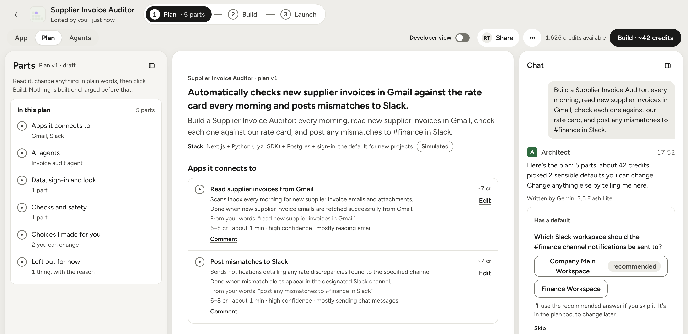
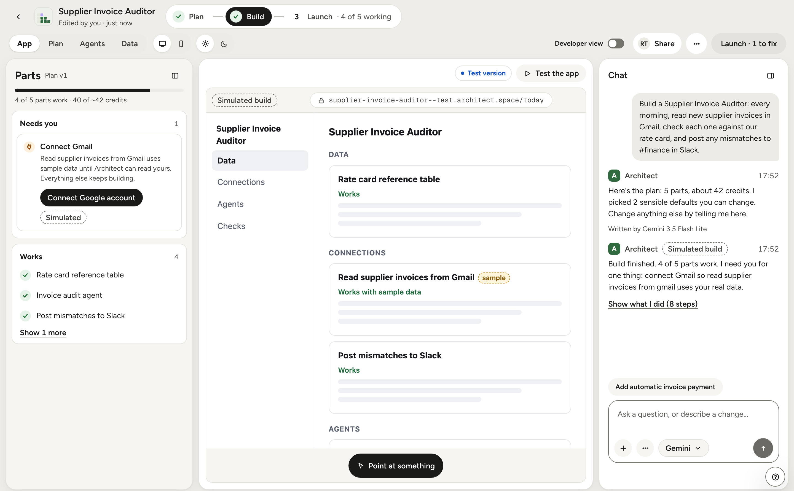
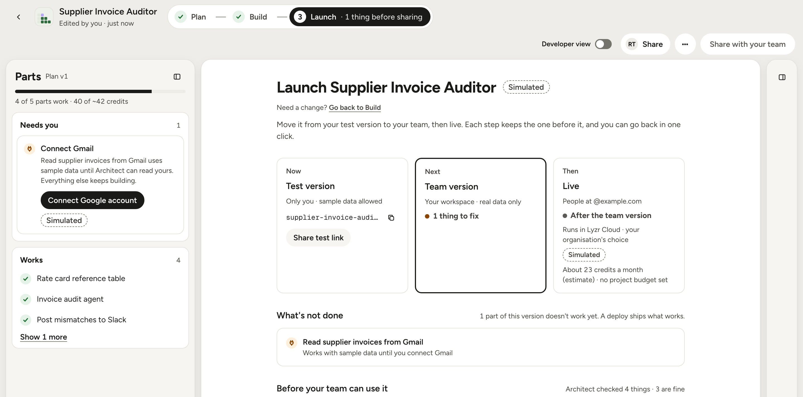

# Architect 2.0

**Architect 2.0: describe an agentic app, see the plan and its cost, and launch it through your company's rules.**

[Live demo](https://architect2-netanya.vercel.app) · Video (coming) · [Architecture](docs/product/ARCHITECTURE.md) · [Diagram](docs/product/diagrams/hero-architecture.png) · [PRD](docs/product/08-PRD-architect-2.md)

One project, Supplier Invoice Auditor, from one prompt:

**1 · Plan.** Parts in plain words, each with its check and cost, before anything is built.

**2 · Build.** Each part built and proved; the Gmail part waits for you, and the app preview fills in as parts work.

**3 · Launch.** Test, then your team, then Live, with what's left to fix.

## Today's Architect → 2.0
From our own audit of today's Architect ([`docs/research/`](docs/research/)), compared with Architect as I tested it in the last week of September 2026:

| Today's Architect | Architect 2.0 |
|---|---|
| A generic planning questionnaire overrode a specific prompt: Gmail, Calendar and Slack became a general research tool | The plan is written from your words; each part quotes your request, and nothing is dropped without a decision |
| "Sample Data" is on by default, so an app looks finished before it works | Every part has its own check, written before the code; only a passing check marks it **Works**, and sample data is labelled |
| Cost is shown afterwards; credits are polled | The cost comes before anything is built: **Build · ~N credits**, with budgets and a cap |
| The model is picked per agent after planning; integrations are guessed from the prompt | The model is picked up front (or Auto); Connections holds sign-in apps, MCP servers and API keys in one place |
| The agent runs with every permission; app repos sit in Lyzr's own GitHub org | Anything risky waits for an approval; a read-only GitHub App works on your own repo |
| VPC and on-prem live in an FAQ; the builder loads about 15 trackers | A governance layer you can see: where it runs, policies, approvals and an audit log |

## Try it in 3 minutes
On the [live demo](https://architect2-netanya.vercel.app), click **Try the demo**: you get your own seeded workspace as Morgan, an Owner, with no sign-up. The tour card on Home has the same five steps:
1. **Write a plan.** Click **Write it**, then **Write the plan**. The prompt asks for Gmail, which this workspace hasn't connected.
2. **Build it.** Click **Build · ~N credits** and watch each part turn **Works**.
3. **Fix a blocker.** The Gmail part says **Needs you**: connect it, and it carries on.
4. **Launch with approval.** Open **Approvals** and approve the waiting Live deploy; you're an Owner.
5. **See Governance and the audit log.** Every decision you just made is there.

Also try ⌘K, **Developer view** › **Terminal & logs**, and Meeting Prep › **Agents** › Research agent › **Try it**: a real run on Lyzr Studio.

## Real vs simulated
**The prototype has no sandbox.** The build is a precomputed event timeline, the preview is a shell drawn from the plan, and the terminal matches six safe commands and never executes anything. Every simulated surface says **Simulated**. Part by part: [ARCHITECTURE.md section 9](docs/product/ARCHITECTURE.md#9-what-the-assignment-prototype-implements).

| Part | Real or simulated | Where |
|---|---|---|
| Sign-in (Google, GitHub, email, demo), workspaces, roles, row-level security | Real | `src/server/workspace.ts`, `supabase/migrations/` |
| Writing the plan, chat and change cards, the conflict guard, the Build gate | Real (Gemini, OpenRouter; Claude and GPT with a key) | `src/server/blueprint/`, `src/lib/gateway.ts` |
| Fallback to OpenRouter when Gemini is out of quota, said in chat | Real | `src/lib/gateway.ts` |
| Agents in each workspace's own Lyzr Studio; Try it; the shared demo agent | Real | `src/server/lyzr.ts`, `src/server/agents-core.ts` |
| MCP servers: Test connection lists their tools | Real (calling the tools is simulated) | `src/server/mcp-client.ts` |
| Keys and passwords, Lyzr keys, MCP auth headers | Real (encrypted in Vault) | `supabase/migrations/0023_m510_pre_m6.sql` |
| GitHub import: repos, files, the analysis | Real (read-only) | `src/server/github.ts`, `src/server/import.ts` |
| Demo access, caps and the 7-day cleanup; analytics | Real | `src/server/actions/auth.ts`, `src/server/demo.ts`, `src/server/analytics.ts` |
| Governance: policies, approvals, budgets, audit | Stored for real; effects simulated | `src/server/policy.ts`, `src/server/approvals.ts` |
| The build, checks and fixes; preview; Developer view; Data tab | Simulated | `src/lib/sim/`, `public/preview/`, `src/lib/terminal.ts` |
| Launch: Test, Team, Live, domains; pull requests; apps' sign-in | Simulated | `src/server/actions/launch.ts`, `src/server/pull-requests.ts` |

**Deliberately not built, and why:**
- **Real code generation and a sandbox.** Running generated code needs sandboxes, a test runner, preview hosting and deploys; a multi-minute build doesn't fit free-tier function limits or Gemini's free quota. The design is in ARCHITECTURE.md.
- **Real sign-in to apps (Gmail, Slack, HubSpot).** Each needs an OAuth app reviewed by the provider; the flows are shown, the accounts aren't linked.
- **Writing to GitHub.** The GitHub App reads only, by choice: a reviewer's repo is never changed.
- **Architect as an MCP server for coding agents.** Specified on `/docs/mcp`; no server accepts tokens yet.
- **Email and billing.** Invites are a link to copy; plans and credits are simulated.

## How we'd measure it
From [PRD section 10](docs/product/08-PRD-architect-2.md#10-success-metrics); the prototype records the first steps in its own events table ([`docs/analytics.sql`](docs/analytics.sql)).
- **North Star:** of the plans confirmed in a week, the share with at least 90% of their parts working within 7 days (target 60%).
- **Leading:** time from the plan shown to Build clicked (under 3 minutes) · plans abandoned before Build (under 30%) · time from prompt to first preview (under 8 minutes).
- **Guardrails:** parts dropped without a recorded decision, and Live deploys with sample data or open security findings (both 0) · check strength: a weekly human audit of parts marked Works (at least 95% really work).

## Why Lyzr Studio agents are the moat
Every app's agents run on one runtime, so they're operated, governed and evaluated the same way.
An agent built for one app can be reused as a part of the next, instead of being rebuilt.
Each workspace's agents live in its own Studio account, editable from Architect or Studio, with no context switch.

## More
- [PRD](docs/product/08-PRD-architect-2.md) · [Architecture](docs/product/ARCHITECTURE.md) · [Research](docs/research/) · [Decisions](docs/DECISIONS.md) · [Coverage of every PRD Must](docs/COVERAGE.md) · [QA report](docs/QA-REPORT.md)
- [Design system](design-system/README.md) · [Setup](docs/SETUP.md) · [How it was built](docs/build/README.md): with Claude Code, from a spec pack

## Third-party code

Tour component adapted from [NiazMorshed2007/shadcn-tour](https://github.com/NiazMorshed2007/shadcn-tour) (MIT). The licence notice is kept at the top of `src/components/tour.tsx`.

---

Built by Netanya Jaison as a prototype for Lyzr's Architect · not an official Lyzr product · [GitHub](https://github.com/netanyaj/architect-2)
