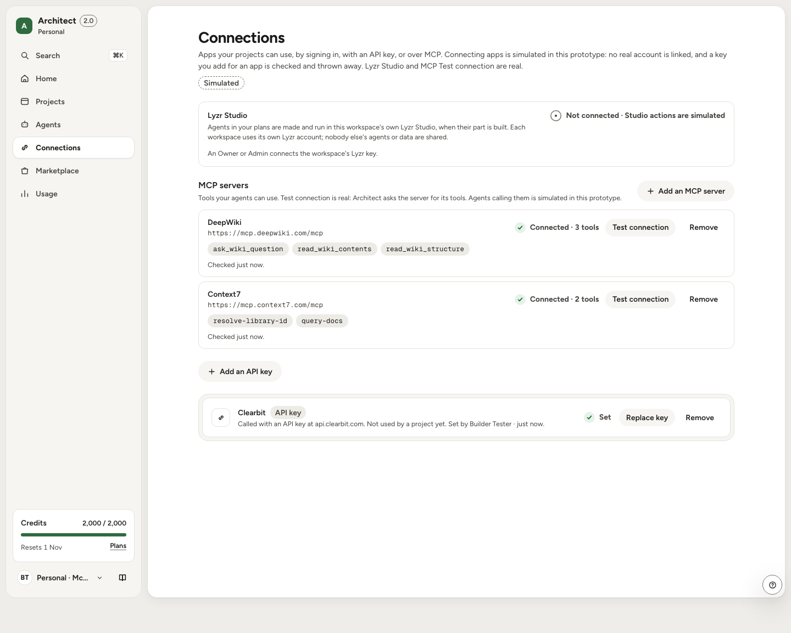

# QA report (M6, 12 Oct 2026)

What was checked before the hand-in, how, and what was found. Production is [ticket-triage-gamma.vercel.app](https://ticket-triage-gamma.vercel.app) at commit `4a5c4e8` (M5.10). The M6 changes (MCP servers in Connections, the landing page, the fixes below) were checked on a local production build against the same database, and are recorded as such. Screenshots are in [`qa/`](qa/).

**Summary:** every PRD Must has a coverage row; F1–F9 pass on production; no 🔴 is left open. Two migrations ship with M6: `0024` (MCP servers) is applied, `0025` (the seed's checks) is waiting for approval.

## 1. Acceptance: PRD Musts and flows F1–F9
**PRD Musts.** All 37 Must rows in PRD section 8 have a row in [`COVERAGE.md`](COVERAGE.md): 9 Done, 8 Done with simulated parts, 20 Simulated; none Partly or Doc only. BL-9 (Connections: OAuth, MCP, API keys) was updated for M6: MCP Test connection is now real.

**Flows on production.** The full Playwright suite (78 tests, `test/e2e/`) ran against production at `4a5c4e8`: 76 passed, 1 skipped by design (a test hook that only exists in development), 1 failed on timing and passed on rerun; that test now accepts either tense of its message. Each test makes its own account and deletes it.

| Flow | What it covers | Evidence | Result |
|---|---|---|---|
| F1 Onboard | Sign-in, two workspaces, Try the demo, the tour | `auth.spec` (5), `m510.spec` demo test, a tour walkthrough on a fresh demo account | Pass |
| F2 Prompt → plan → Build → proof → Launch | The core flow | `plan.spec` (3), `build.spec` (5), `launch.spec`, `launch-fast.spec`; the tour walkthrough: a real plan in 12 s, the build, the Gmail blocker | Pass |
| F3 Import a repo | GitHub App, analysis, the plan from the repo, PR | `import.spec` (3), `f3-import-to-pr.spec` | Pass (PR simulated) |
| F4 Bring your own coding agent | Project tokens, approval, the scripted MCP session | `coding-agent.spec` (2) | Pass (simulated) |
| F5 Connect an integration | Connect on the part, approval for a held app, MCP servers | `approvals.spec` (3), `build.spec`, `m5-followup.spec`; MCP: unit tests and a live Test connection (below) | Pass |
| F6 Enterprise setup | Governance policies, rules, budgets, keys, audit | `governance.spec` (3), `rules-budgets-keys.spec` (3), `egress.spec` (2) | Pass (effects simulated) |
| F7 Iterate after launch | Chat change cards, code edits, update Live | `launch.spec`, `code-edits.spec`, `pull-requests.spec` (2) | Pass |
| F8 Hand-off | Morgan → Sam ownership | `handoff.spec` | Pass |
| F9 Move a 1.0 app to 2.0 | The legacy app, Move to 2.0 | `move-and-more.spec` (3), `workspace.spec` (3) | Pass |

**The M6 code, on a local production build:** the full suite, 80 tests. The first run lost its network part-way (13 tests couldn't reach Supabase to make their account); rerun one file at a time, every test passes except the rate-limit test, which needs a development-only hook and passes on the dev server. The run found two things, both fixed: a governance test still expected the old MCP line in agent tools (updated for M6), and a real bug in the Developer panel's terminal (below). One plan came back invalid twice from the model and passed on rerun.

**M6 additions, on a local production build:** MCP servers: adding DeepWiki's public server ran a real `initialize` and `tools/list` and listed its 3 tools in 2.3 s; the allowed list in Governance links to the row; an agent picks "MCP: DeepWiki" ([connections](qa/after-mcp-connections.png), [governance](qa/after-mcp-governance.png), [agent](qa/after-mcp-agent-tools.png)). Guards: 5 unit tests (private, loopback, link-local and mapped addresses refused, including a host that resolves to one), 3 action tests (allowed list, the header kept in Vault, 10 tests an hour, every test audited). The landing page: [light](qa/after-landing-1440-light.png), [dark](qa/after-landing-1440-dark.png), [390 px](qa/after-landing-390-light.png).

**Governance off: who can connect what.** In a Personal workspace (governance off), Connections is where things get connected, and governance adds no rules on top:
- **A Builder** added an MCP server (Context7: a real Test connection listed its 2 tools) and an API-key app (Clearbit, recorded as set by the Builder). The Lyzr Studio card tells a Builder that "An Owner or Admin connects the workspace's Lyzr key" ([screenshot](qa/governance-off-builder-connections.png)).
- **The Owner** added the workspace's Lyzr key, checked with Lyzr, and the card shows Connected with only its last 4 characters ([screenshot](qa/governance-off-owner-connections.png)).
- With governance on, only allowed apps and servers can be added, and an admin rule can limit connecting to Owners and Admins (`governance.spec`). The check is the e2e test "governance off (Personal)" in `m6.spec`, run on a local production build: it passes, and its accounts are deleted afterwards.

## 2. UX and UI review
A fresh demo account on production, reviewed with the checklist of the third-party `review-ux-ui` skill (Nielsen's 10 heuristics, WCAG 2.1 AA, keyboard, flows, forms), read first and applied by hand, plus axe-core for contrast, names and roles.

| Heuristic | Finding |
|---|---|
| Visibility of system status | Strong: parts turn Works live; the build card and progress line; "Checked just now" on MCP tests |
| Match with the real world | Plain words throughout; one leftover: seeded checks read "Done when … passes its check" (fixed, below) |
| User control and freedom | Undo on delete, Discard on agent edits, "Go back to Build" from Launch, one-click going back on Live |
| Consistency and standards | One primary per screen; status as icon plus word; quiet secondary buttons |
| Error prevention | Nothing builds without Build; cost before every paid action; approvals before risky ones |
| Recognition rather than recall | The tour, ⌘K, Needs you items with the fix on the card |
| Flexibility and efficiency | ⌘K, keyboard tabs, Developer view for builders who want code |
| Aesthetic and minimalist design | Clean at 1440 and 390; the preview's section list overlapped at desktop widths (fixed) |
| Recognise and recover from errors | Errors say what happened and what to do ("Needs a valid auth header", "Lyzr didn't accept that key") |
| Help and documentation | Help panel, the tour, /docs/mcp |

### Findings
| | Finding | Where | Status |
|---|---|---|---|
| 🔴 | The preview's section list ran sideways and overlapped its own headings ("Agents" over "DATA") on the main build screen | Every project's App view at 1440 ([before](qa/before-preview-tabs.png), [after](qa/after-preview-tabs-1440-light.png)) | **Fixed** |
| 🔴 | The Lyzr key field shrank to a few characters beside its button on phones | Connections at 390 px ([before](qa/before-lyzr-key-390.png), [after](qa/after-lyzr-key-390-light.png)) | **Fixed** |
| 🔴 | Seeded parts read "Done when done when … passes its check" | The plan view of every seeded project ([before](qa/before-done-when.png), [after](qa/after-done-when-1440-light.png)) | **Fixed** in the view; the seed's wording is migration `0025` (each check says what it proves), waiting for approval |
| 🔴 | axe: the preview's group headings were 3.2:1 contrast | The preview shell | **Fixed** (now 6.4:1) |
| 🔴 | axe: tool initials had a label on an element with no role | Agents list | **Fixed** (`role="img"`) |
| 🔴 | Keyboard: the preview frame took focus with no visible ring | Every project's App view | **Fixed**: CSS `:focus` doesn't match a frame once focus is inside it, so the ring follows the page's own blur; re-checked by tabbing into it (a 2 px ring) |
| 🔴 | The terminal lost a command's output when a second command was typed before the first answered | Developer view › Terminal & logs | **Fixed**: every result appends to the latest lines (found by `m55.spec`) |
| 🟡 | At 1024 px with Parts and Chat open, the preview is narrow | Project App view | Open: auto-collapse Parts below 1100 px until the person touches it |
| 🟡 | Research agent (the demo agent) shows "Claude Sonnet · Sim" in its read-only model picker, though it runs on Gemini 3.1 Flash Lite | Meeting Prep › Agents | Open: show Studio's model for the demo agent |
| 🟡 | The landing page's Video link says "soon" until the video is published | `/` | Open: set `NEXT_PUBLIC_VIDEO_URL` |
| 🟡 | Seeded agents' instructions repeat the placeholder check | Agents › Instructions on seeded projects | Open: new and reset workspaces take the new checks once `0025` is applied; existing agent rows keep theirs |
| 🟢 | Project names on Home are links under 24 px tall, but the whole row is clickable | Home | Fine (the row is the target) |
| 🟢 | The preview's "This week" wraps on phones | Meeting Prep preview at 390 | Fine (it's the sample app) |

## 3. Visual QA
Every page and every seeded project (App, Plan, Agents, Launch) at 1440, 1024 and 390 px, light and dark: 198 screenshots, plus Personal's empty states and a project that doesn't exist.
- **Layout:** no page scrolls sideways at any width.
- **States:** empty (Personal: Projects, Agents, Connections, Usage), loading (plan writing, build loader), waiting (Needs you, approvals) and error ("This project isn't here", a failed MCP test) all render in both themes.
- **Accessibility (axe, WCAG 2.1 AA, 1440 and 1024, both themes):** before the fixes, 2 rules (contrast in the preview shell, a label without a role); on the fixed build, **no violations**. **Keyboard:** 40 tab stops each on Home, Connections and a project: every stop shows the focus ring, the preview frame included.
- **On the rerun against the fixed local build,** 9 of 198 page loads timed out at 60 s under load (all 1024 px dark, plus one at 390 px); the same pages loaded at every other width and theme, and on production.

## 4. Hygiene and safety
| Check | How | Result |
|---|---|---|
| Keys in git history | `gitleaks git` over all 134 commits, then a search for real key shapes (Google, OpenRouter, Anthropic, Supabase JWT, GitHub tokens, private keys) | 2 findings, both made-up test values (a fake key in the migration test, a fixed invite token in a unit test); no real key; only `.env.example` ever committed, names only |
| Row-level security | Two fresh accounts; B tries to read A's rows; signed out too | `workspace_secrets`, `project_keys`, `connections`, `audit_log`, `user_preferences`, `terminal_sessions`, `members`: the other account and signed-out visitors see 0 rows. `analytics_events`: denied to everyone, owner included. The Vault functions are denied to a signed-in Owner; a project key's row holds only a Vault id |
| Demo caps | A fresh demo account on production with 5 plans already today, then 10 demo-agent runs | The 6th plan is refused ("The demo writes up to 5 plans a day"); the 11th demo-agent run is refused |
| 7-day cleanup | The cron endpoint without its secret; a unit test of the cleanup | 401 (the secret is set); anonymous accounts over 7 days go with their workspaces, newer ones and real accounts stay |
| Test projects | Leftover test accounts and their projects | The six stale test accounts, the screenshot account and the QA runs' demo accounts are deleted (12 Oct). Two anonymous demo sessions that aren't ours are left for the 7-day cleanup. e2e tests make their own account per run and delete it; `scripts/delete-test-accounts.mjs` sweeps any left over. The seed itself has no test data; its placeholder checks are replaced by `0025` |
| The repo | A scan of every tracked file for wording about other people's work | Clean; a local pre-commit hook blocks it |
