# Architect 2.0: information architecture and flows

_Draft 2 · 2026-10-03. Built on the PRD (`08`). Every diagram has a PNG in `diagrams/` and an editable source in `diagrams/src/`._

## 1. Design principles (where each decision comes from)
| Principle | What it decides in the UI | From |
|---|---|---|
| **The Blueprint is the spine** | It is always visible on the left of a project. Everything else shows evidence for one of its items | A, the core |
| **Chat is for asking, not the record** | Requests in chat become proposed Blueprint changes with a cost. The chat thread is never the source of truth | Intent loss (audit) |
| **Evidence beside every promise** | Selecting an item highlights it in the preview and opens its proof underneath | Proof per item (A-7) |
| **One app, depth by view** | Builder and Developer views of the same project. Developer view keeps the same layout and adds Code and Terminal tabs, per-item diffs and PR status in place | Two audiences, one architecture |
| **Blueprint first, build on your click** | Send on Home opens the project with the Blueprint streaming in; the build starts only when the user clicks **Build · ~N credits** | A-0 |
| **Irreversible actions have one home** | Deploy is the only primary button in a project, top right. Never triggered from chat | Approvals (C-10) |
| **Governance shows up only where it affects you** | Admins get a Governance area. Everyone else sees its effects inline: "Needs approval", allowed models only | Governance as a layer |

**What we deliberately did not do:**
- **The usual chat-left, preview-right layout.** In that layout the conversation becomes the record. Here the Blueprint holds the record and chat is a side panel.
- **Mode tabs before the first prompt.** The Builder/Developer switch lives inside a project, not at the door.

## 2. Map of the product
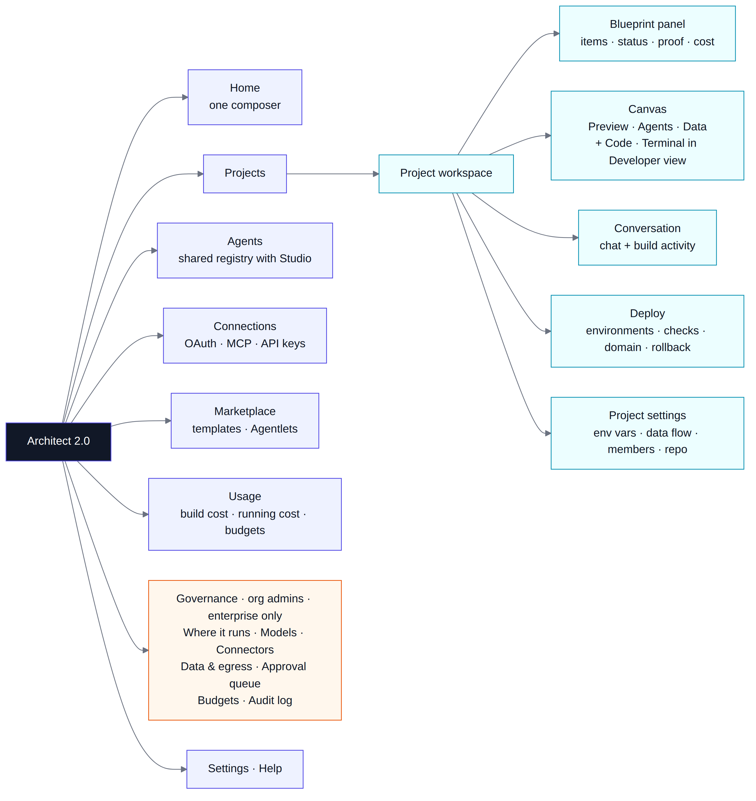

| Area | What it holds | Who uses it |
|---|---|---|
| **Home** | One composer (prompt, attach, import repo, template, "Help me decide"), recent projects with readiness, templates and Agentlets (Lyzr's agent marketplace) | Everyone |
| **Projects** | All projects, filterable by readiness and environment | Everyone |
| **Agents** | The shared agent registry. The same agents appear in Lyzr Studio, and edits sync both ways | Everyone |
| **Connections** | OAuth accounts, MCP servers and API keys, with status | Everyone |
| **Marketplace** | Templates and Agentlets; apps are published here from the Deploy drawer | Everyone |
| **Usage** | Build cost (your changes and fix attempts as separate lines) and running cost, shown separately; budgets | Everyone |
| **Governance** | Where it runs, models, connectors, data and egress, approval queue, budgets, audit log | Org admins, only when the enterprise layer is on |
| **Settings · Help** | Profile, workspace, members, billing plan; help with a human escalation path | Everyone |

## 3. Key screens
### 3.1 Home
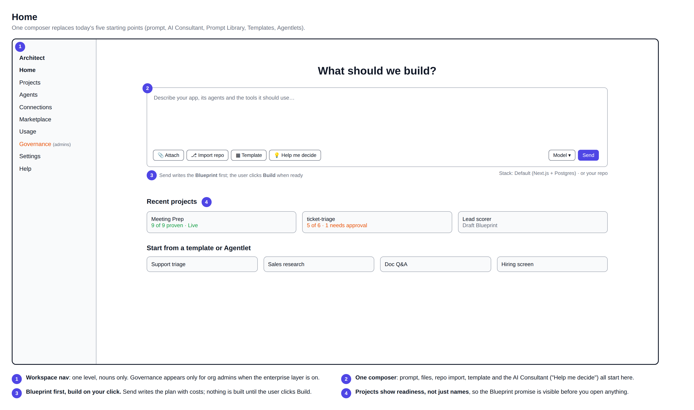

- **One composer** replaces today's five separate starting points: prompt, AI Consultant, Prompt Library, Templates and Agentlets.
- **Send** generates the Blueprint. There is no split button and no separate review mode: the Blueprint always comes first, and the user clicks **Build** when ready.
- **The model chip** shows only allowed models when the enterprise layer is on.
- **The stack line** under the composer shows "Default stack" or the imported repo and branch.
- **Recent projects show readiness** ("9 of 9 proven · Live"), not just names.

### 3.2 Project workspace
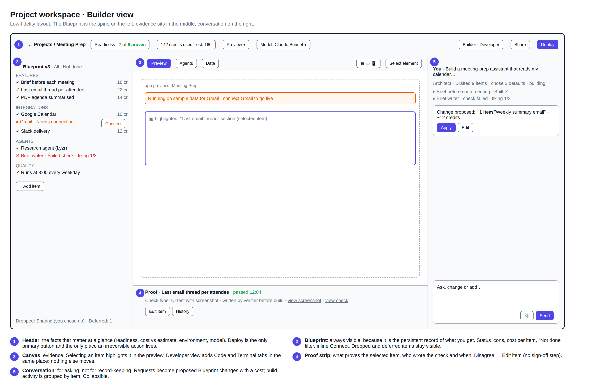

| Region | Contents | Notes |
|---|---|---|
| **Header** | Back to Projects · name · **Readiness** ("7 of 9 proven", opens the readiness view) · **cost used vs estimate** · environment switcher · model · Builder/Developer · Share · **Deploy** | Deploy is disabled with a reason ("2 items not proven") until pre-publish checks pass |
| **Blueprint panel** (left) | Version, All / Not done filter, items grouped (Features, Data, Integrations, Agents, Quality), each with a status icon, cost, and an inline action (Connect, Fixing 1/3) · + Add item · Dropped and Deferred kept at the bottom | Selecting an item focuses the canvas on it |
| **Canvas** (centre) | Builder view: **Preview · Agents · Data**. Developer view adds **Code · Terminal** | Preview: device sizes, Select element (attaches to chat), console drawer |
| **Proof strip** (under canvas) | For the selected item: check type, result, time, who wrote the check, screenshot, the check itself · **Edit item** · History | No sign-off button. Disagreement goes through Edit item |
| **Conversation** (right) | Thread plus build activity grouped by item · proposed-change cards ("+1 item · ~12 credits · Apply / Edit") · blocking-question cards · composer | Collapsible to give the canvas more room |

**Developer view (Sam).** The same layout, with:
- Code and Terminal tabs in the canvas;
- a per-item diff in the proof strip ("Changes for this item");
- the branch and PR status in the header;
- environment variables and the agent token in Project settings.

### 3.3 Deploy (drawer from the Deploy button)
- **Environments:** Preview → Staging → Production, each with its URL and data.
- **Pre-publish checks:** tests, security and PII scan, missing secrets, sample data. Each check names the item it belongs to and its fix.
- **Approvals:** shown only with the enterprise layer on, along with who has to approve.
- **Also here:** custom domain, version history, one-click rollback, and "Publish to marketplace".

### 3.4 Governance (org admins, enterprise layer, simulated)
- **Sections:** Where it runs · Models · Connectors & MCP · Data & egress · Approval queue · Budgets · Audit log.
- **The data-flow view** sits per project under Project settings. It is the bridge between admin rules and what builders see.

## 4. The nine flows
### F1. Onboard
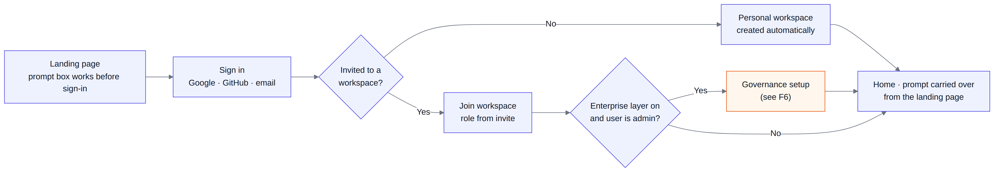

- A prompt typed on the landing page survives sign-in and lands in the Home composer.
- No workspace setup questions for individuals.
- Admins of an enterprise workspace go through governance setup (F6) first.

### F2. One prompt → Blueprint → Build → proof → deploy (Morgan, the core flow)
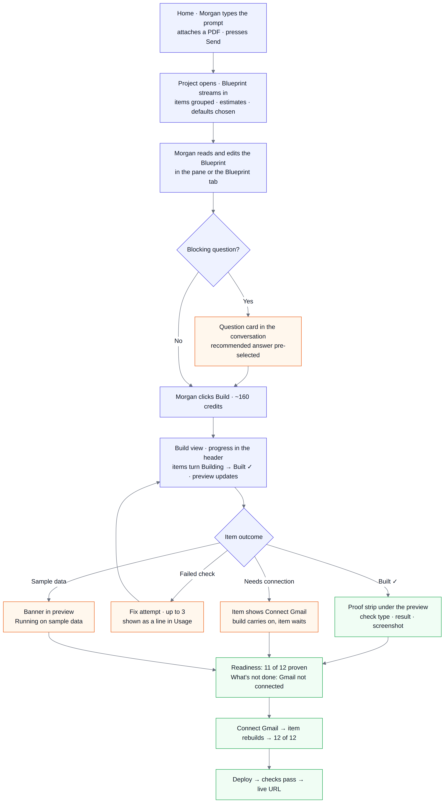

| Step | Screen | What the user sees |
|---|---|---|
| 1 | Home | Prompt + PDF → **Send** |
| 2 | Workspace | Blueprint items stream into the left panel with estimates; defaults are listed in the conversation ("I chose: weekday mornings, Slack DM") |
| 3 | Workspace | Only if needed: a card for each blocking question (most builds have none), each with a recommended answer |
| 4 | Blueprint pane | Morgan reads and edits the Blueprint, then clicks **Build · ~160 credits**. Nothing is built before this click |
| 5 | Workspace | Items turn Building → Built ✓; the preview fills in; the proof strip updates per item |
| 6 | Workspace | Gmail item: **Needs connection** and a sample-data banner. The build carries on |
| 7 | Workspace | Brief writer fails its check → "Fixing 1/3" → Built ✓; the fix shows as its own line in Usage |
| 8 | Header | Readiness 8 of 9 → Connect Gmail inline → 9 of 9 |
| 9 | Deploy drawer | Checks pass → live URL |

**Edge cases**
- **Budget hit mid-build:** the build pauses, finished items are kept, and the remaining cost is shown.
- **Item still failing after 3 fix attempts:** the build pauses on that item only, and offers Edit item or Defer.
- **User closes the tab:** the build continues and the project store keeps everything.

### F3. Import an existing repo (Sam)
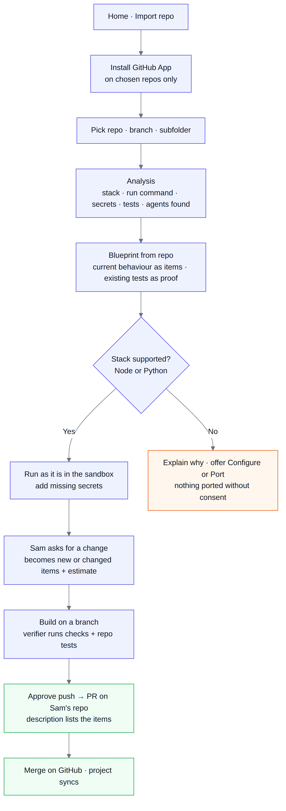

- The GitHub App is installed on chosen repos only.
- The analysis turns into a **Blueprint from repo**, where existing tests become proof.
- **Node and Python run as they are.** Anything else gets "Configure" or "Port", and nothing is ported without consent.
- Changes go to a branch and come back as a PR whose description lists the items.

### F4. Bring your own coding agent (Sam)
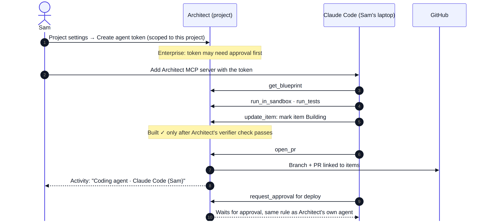

- The project token is created in Project settings. It may need approval on the enterprise layer.
- The user's coding agent works through the same tools as Architect's own agent.
- **It cannot mark an item Built ✓.** Only the verifier's check can.
- Deploy requests wait for approval like any other.

### F5. Connect an integration that needs approval
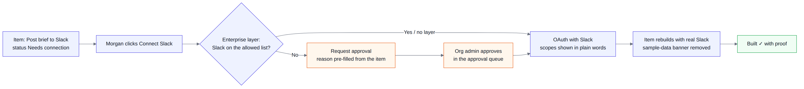

- **Connect** sits on the item itself, so there's no hunting through settings.
- If the connector isn't on the org's allowed list, the request is pre-filled from the item for the org admin.

### F6. Enterprise setup and approval queue (governance layer, simulated)
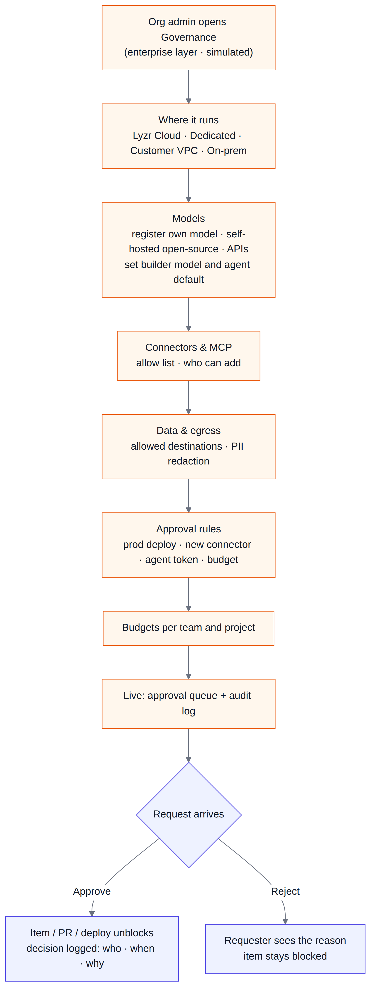

- It's a linear setup that runs once.
- After that the admin mostly lives in the approval queue.
- Every decision records who, when and why.

### F7. Iterate after launch
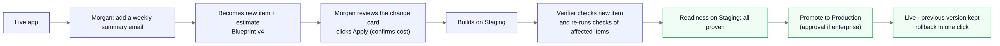

- A change request becomes a new Blueprint version with new items and an estimate.
- It builds on Staging, where the verifier re-checks the new item and every affected item.
- Promote to Production, with the previous version kept for rollback.

### F8. Hand off from Morgan to Sam (the main journey)
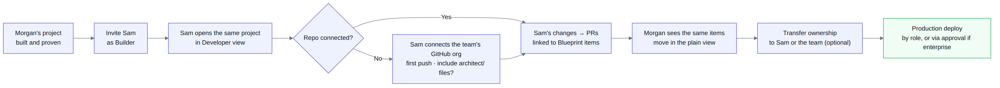

- Morgan invites Sam to the workspace as a Builder and shares the project; Sam lands in Developer view of the same project, with the same Blueprint.
- If the project has no repo yet, Sam connects the team's GitHub org and makes the first push, choosing whether to include the `architect/` files. The repo is owned by the team from then on.
- Sam's changes come back as PRs linked to Blueprint items; Morgan sees the same items move in the plain view and can keep requesting changes.
- Ownership can be transferred to Sam (or the team) from Project settings; Production deploys follow workspace roles and, if enabled, the approval rules.

### F9. Move an existing Architect app to 2.0
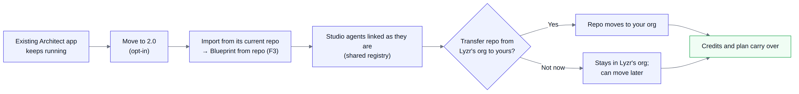

- Existing apps keep running unchanged; nothing is forced.
- "Move to 2.0" imports the app from its current repo as a Blueprint from repo (F3), with its Studio agents linked as they are (the registry is shared).
- The user chooses to transfer the repo from Lyzr's org to their own; credits and plan carry over.

## 5. States every screen must handle
| State | Rule |
|---|---|
| Empty | Say what to do next in one line, plus one button (e.g. Projects: "No projects yet · Start from Home") |
| Building | Show item-level progress, never a spinner or a tips carousel |
| Waiting | Name what it's waiting on and give the action inline (Connect, Request approval) |
| Failed | Name the item, the check, the reason and the next step; fix attempts are counted visibly (x/3) |
| Sample data | A persistent banner in the preview, plus a flag in pre-publish checks |
| Blocked by policy | "Needs approval" with who approves; never a silent disable |

## 6. Decision diagrams (from the PRD)
| Diagram | Shows |
|---|---|
| `01-product-layers` | Baseline, A, B and the governance layer around one engine |
| `02-blueprint-first-flow` | Prompt → Blueprint → user clicks Build → proof → deploy, with blocking questions |
| `03-item-lifecycle` | Every status a Blueprint item can have, and how it moves between them |
| `04-proof-verification` | Verifier writes checks before code; builder can't edit them |
| `05-cost-model` | Build cost (confirmed; fixes included and capped) vs running cost (separate meter) |
| `06-metrics-tree` | North Star, leading, lagging and guardrail metrics |
| `07-governance-layer` | What admins set, and what builders see as a result |
| `08-app-scaling` | How a built app scales horizontally and vertically, and how load is proven |

**Roles** are defined in the PRD (section 9): Owner/Admin (org admins when the enterprise layer is on), Builder, Viewer.

## Interface words and final screens (design v3, Soft Tray, 4 Oct 2026)
- **Final screens:** the final UI is the "Architect 2.0 – Modern direction" canvas, page "Final screens · Soft Tray" (17 screens). The wireframes above (10-sitemap, 11-project-workspace, 12-home) show structure only.
- **Header:** the workspace header is a Plan · Build · Launch stepper. The environment picker and readiness meter are gone.

| This document | The interface says |
|---|---|
| Blueprint | plan |
| item | part |
| Built / proven | Works |
| Preview · Staging · Production | Test version · Team version · Live |
| Plan mode | Talk first |
| Paused | Blocked (with the reason) |
| Deploy drawer | Launch stage |
| Secrets / env vars | Keys and passwords |
