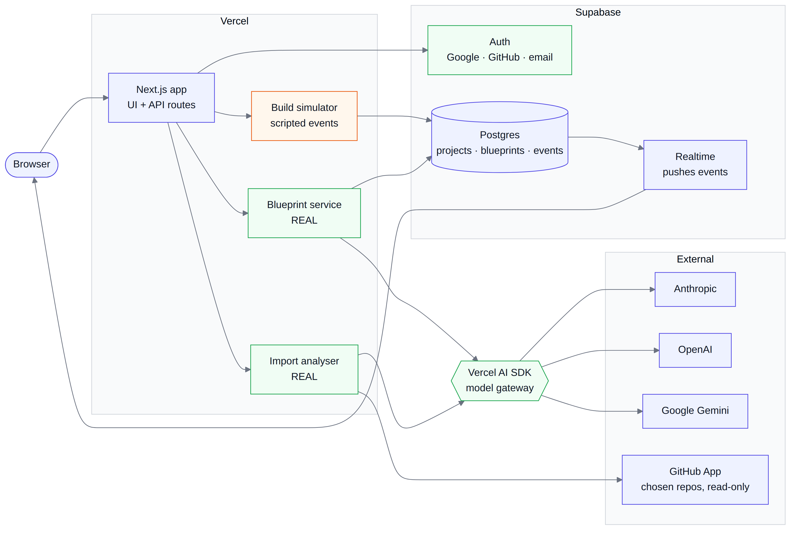
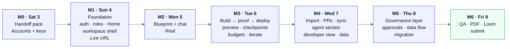

# Architect 2.0 prototype: stack and milestones

_Draft 3 · 2026-10-03. Built from PRD section 14 ("What the assignment prototype builds") and ARCHITECTURE.md section 9. Diagrams: `diagrams/P1-prototype-stack.png`, `diagrams/P2-milestones.png`._

**Goal:** by Fri 9 Oct, a live URL where a judge can type one prompt and watch a real Blueprint get drafted, a simulated build turn items green with proof, and a deploy go live. Around that core, every requirement the PRD marks Real or Sim is built; nothing is cut.

**Approach:** Netanya builds solo, with Claude Code writing the code from a handoff pack. Every simulated part is labelled "Simulated" in the UI, so nothing pretends to be real.

## 1. Stack

| Layer | Choice | Why | Not chosen |
|---|---|---|---|
| App | Next.js (App Router) + TypeScript, Tailwind, shadcn/ui | The fastest route to a polished UI; Claude Code knows it well | Remix, Vite SPA: fewer ready-made parts |
| Hosting | Vercel (free tier) | A live URL from day 1; preview deploys per branch | Netlify: works too, but Vercel pairs more simply with Next.js |
| Auth | Supabase Auth: Google, GitHub, email | Covers BL-1's three sign-ins with no custom code | Auth.js: more wiring |
| Data | Supabase Postgres | Projects, Blueprints, versions, events and seeded governance policies in one place | |
| Live updates | Supabase Realtime on the `events` table | Stands in for the realtime hub: items turn green as events land, with no polling (NFR-3) | Polling: the thing we criticise today |
| Model gateway | Vercel AI SDK with Google (Gemini, free tier) and OpenRouter (free models) as real providers; Claude and GPT become real when a key is added, otherwise simulated through Gemini; structured output checked by a schema | A real model picker (BL-3) at zero cost; one interface, like the gateway in the architecture, so paid providers are a config change | Calling each API separately |
| GitHub | A GitHub App with read-only access to chosen repos (contents, metadata) | Matches B-1: no full `repo` scope | Supabase's GitHub sign-in token: it can't read private repos without broad scopes |
| Build simulator | A server-side script engine that writes timed events to Postgres | Drives the same UI states a real orchestrator would; it is keyed to the real Blueprint's items | A hard-coded video-like demo: it breaks the moment the Blueprint differs |
| Preview | A pre-built demo app ("Meeting Prep"), shown full-size in an iframe with its own navigation and URL bar, with a sample-data banner | It shows A-8 honestly without real code generation | Real sandbox: the PRD marks the build as Sim for the prototype |
| Testing | Playwright smoke test of the core flow; schema tests on Blueprint output | Guards the demo path before submission | |

## 2. What is Real and what is Simulated
Everything the PRD marks **Real** or **Sim** is built. Only items marked **Doc** stay documented: BL-16 app analytics, BL-17 human support, A-12 Blueprint export, C-8 tracker-free tenant, C-9 policy as code and SSO/SCIM.

| Real | Simulated (labelled "Simulated" in the UI) |
|---|---|
| Sign-in (Google, GitHub, email), workspaces, roles, invites; Home composer; Blueprint-first flow with defaulted and blocking questions and the Build gate, conflict guard, estimates and versions; model picker (Claude, GPT, Gemini); chat that turns requests into proposed Blueprint changes, with plan mode and a message queue; GitHub connect, repo list and import analysis | Build stream and statuses, proof strip, fix loop, readiness, Usage lines, budgets; preview with device sizes, select element and console; checkpoints; environments, pre-publish checks and deploy; PRs and two-way sync; developer view; agent section and other-framework agents; coding-agent activity; data tab; the whole governance layer |

**How the simulator stays believable:** it reads the real Blueprint and plays a scenario over its items:
- most items go Building → Built ✓ with a check and a screenshot;
- one integration item stops at **Needs connection**, with a sample-data banner;
- one item fails its check, goes "Fixing 1/3", then passes, and the fix shows as its own Usage line;
- for an unrecognised prompt, the same pattern is applied to whatever items were generated.

**Demo prompt:** "Before each meeting on my calendar, send me a Slack brief with each attendee's last email thread, a summary of any attached agenda PDF, and three talking points." (the F2 flow, as drawn on the final screens).

## 3. Milestones

Each milestone ends with something that can be shown on the live URL.

| # | Day | Scope (PRD IDs) | Done when |
|---|---|---|---|
| M0 | Sat 3 | Handoff pack (CLAUDE.md, build spec, data model, simulator scenarios, design tokens, copy); accounts and keys | Claude Code can start without asking product questions |
| M1 | Sun 4 | **Foundation.** Repo, Vercel, design tokens and component kit; sign-in, workspaces, roles and invites (BL-1, BL-15); Home composer (BL-2); Projects; Connections hub (BL-9); Usage and Settings pages; workspace shell (Blueprint panel, canvas, proof strip, conversation) | A judge can sign in, invite someone and open an empty workspace on the live URL |
| M2 | Mon 5 | **Blueprint and chat (Real).** A-0 to A-5; model picker (BL-3); Build button (always manual); version compare; chat with plan mode, message queue and proposed-change cards (BL-4, A-11 proposal) | The demo prompt gives a sensible Blueprint in under 60 s on Gemini and the OpenRouter model; a chat request returns a change card with an estimate |
| M3 | Tue 6 | **Build to deploy (Sim).** Simulator and Realtime; BL-5, A-6 to A-10; preview with device sizes, select element → chat, console (BL-6); checkpoints (BL-7); budgets (BL-14); Needs connection → Connect inline; environments, pre-publish checks, deploy, rollback (BL-12, BL-13); building approved changes (F7) | F2 and F7 run end to end, prompt to live URL |
| M4 | Wed 7 | **Developers and agents.** Import (B-1, B-2 Real), run as is (B-3), PRs and sync (B-4, B-5, BL-11); agent section with graph, inline edit, playground and traces (BL-8); CrewAI and LangGraph agents (B-6); coding-agent activity and the MCP tool spec page (B-7); default stack (B-8); developer view (B-9); data tab and auth toggle (BL-10) | F3, F4 and F8 can be shown |
| M5 | Thu 8 | **Governance layer and remaining flows.** C-1 to C-7 and C-10: setup, model and connector policies, egress rules and data-flow view, approval queue, audit log, org budgets (F5, F6); migration (F9) | F5, F6 and F9 can be shown; every PRD Real/Sim row is done |
| M6 | Fri 9 | **QA and submission.** Acceptance-criteria pass, accessibility pass, empty and error states; README; one architecture PDF; absolute image links in ARCHITECTURE.md; PRD links filled in; Loom; form | Submitted |

**Capacity:** this is the full PRD scope with no cut list, so there is no slack inside M1 to M5. M6 is the only buffer. To keep it, Claude Code works on two branches in parallel from M3 onward (simulated screens are independent of each other), and any milestone not done by its evening carries into the next morning first.

## 4. Before M1: what Netanya sets up
Claude never enters your credentials; you create these and paste the keys into `.env.local` and Vercel yourself.

- [ ] Vercel account, connected to your GitHub
- [ ] Supabase project; enable Google, GitHub and email sign-in
- [ ] Google AI Studio (Gemini) key on the free tier, no billing attached
- [ ] Optional: OpenRouter key (free models only, no credit added)
- [ ] Optional later: Anthropic and OpenAI keys, which turn Claude and GPT from simulated to real
- [ ] GitHub App (read-only contents and metadata), created from your account
- [ ] Public GitHub repo for the prototype (publishing needs your OK)

## 5. Risks
| Risk | Impact | Mitigation |
|---|---|---|
| Full scope in five build days | A milestone slips | Two parallel Claude Code branches from M3; screens follow the wireframes, so no design time is spent during the build; M6 absorbs a slip |
| Blueprint output varies between runs or models | A messy demo | Schema-checked output, a fixed system prompt, and the 3 demo prompts tested on all three models before M2 closes |
| Model calls take too long | Requests time out on Vercel | Stream the Blueprint item by item; keep each call within the function limit |
| Simulated parts read as fake | Judges discount the work | "Simulated" badges; the Loom says exactly what is real; ARCHITECTURE.md shows how each one becomes real |
| GitHub App setup takes longer than planned | M4 slips | Set it up in M0, before any code |
| A key leaks into the public repo | Security issue | `.env*` in `.gitignore` from the first commit; secret scanning on before going public |

## 6. Definition of done (for each milestone)
- Deployed to the live URL, not just running locally
- Matches the final screens canvas ("Architect 2.0 – Final screens") and the Architect design system; flows as in `10-IA-and-flows.md`
- Empty, waiting and failed states handled (section 5 of that doc)
- Simulated parts labelled
- No keys or personal data in the repo
