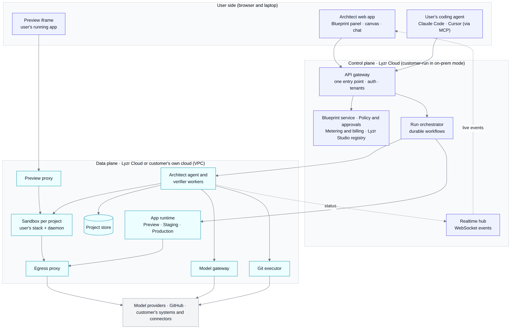
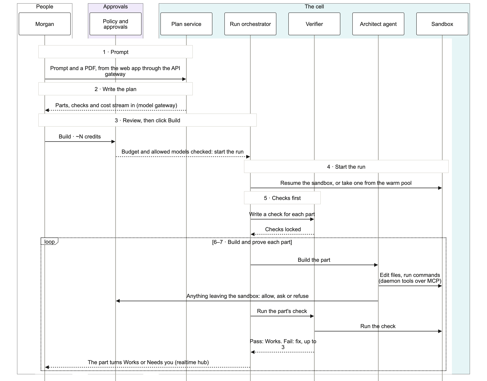
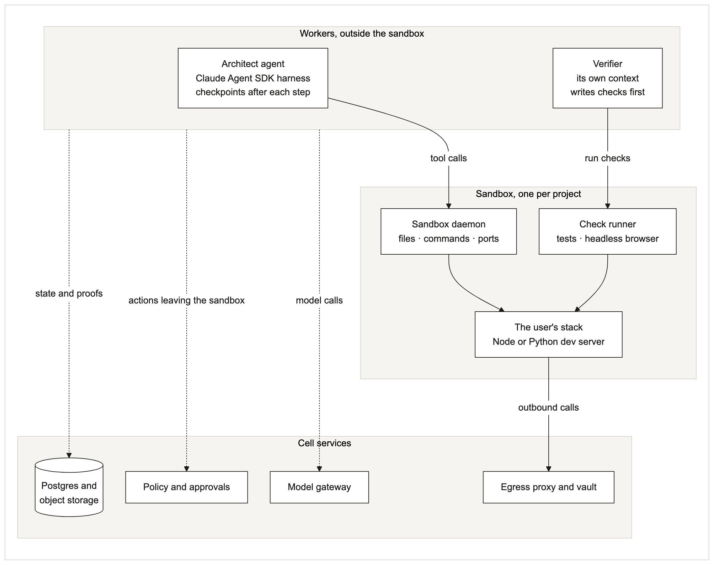
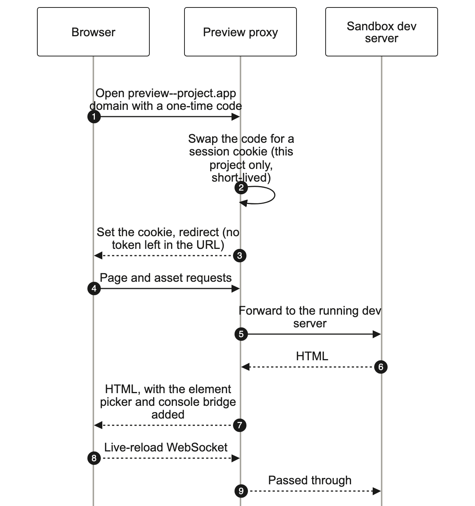
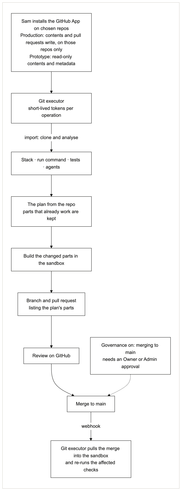
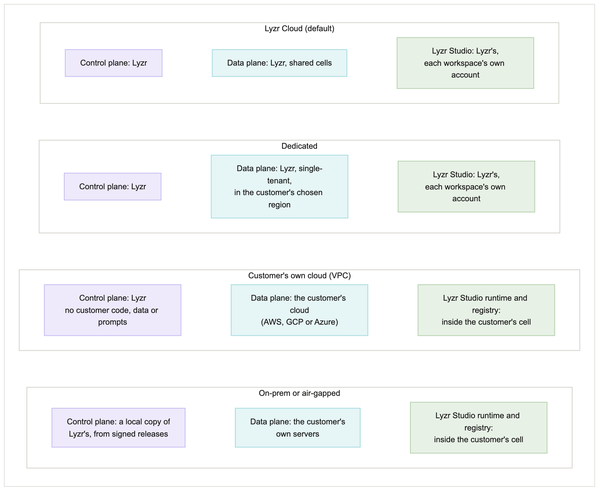
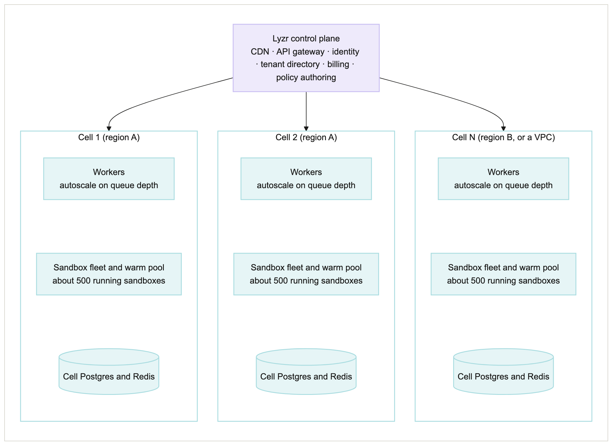

# Architect 2.0: architecture

_Owner: Netanya Jaison · Draft 1 · 2026-10-03. Companion to the PRD (`08-PRD-architect-2.md`). Diagrams are in `diagrams/` (PNG plus editable source)._

## At a glance
- **An evolution, not a rewrite.** Today's Architect already has the right foundations: per-project sandboxes (E2B), an agent harness based on the Claude Agent SDK, a WebSocket stream, a preview proxy, multi-tenant configuration and Lyzr Studio's model catalogue and agent registry. 2.0 keeps them and changes what blocks trust, developers, scale and enterprise use.
- **Control plane and data plane are split.** The control plane (accounts, policy, billing, Blueprint IDs and statuses) can stay in Lyzr Cloud while the data plane (sandboxes, agents, models, code, data, deployed apps) runs in the customer's own cloud. This one decision makes the sovereign offer possible.
- **The agent loop moves out of the sandbox.** The Architect agent and the verifier run as workers that reach into the sandbox through a small daemon. A crashed sandbox no longer loses work, and keys never sit inside it.
- **Every agent uses the same tool surface.** The sandbox daemon exposes its tools over MCP (Model Context Protocol), so the Architect agent and a user's own coding agent (Claude Code, Cursor) call exactly the same tools under the same policy.
- **One runtime for deployed apps everywhere.** Apps move from today's Netlify hosting to a container runtime that runs the same way in Lyzr Cloud, a customer's cloud or on-prem, and supports Python back ends, agent workers and autoscaling.

## 1. Starting point: what exists today, and what changes
Based on our network captures and tests of today's Architect (`03-architect-architecture-today.md`, `04-import-audit.md`) and a DNS check on 2026-10-03.

| Area | Today | 2.0 | Why |
|---|---|---|---|
| Builder front end | Next.js on Vercel; the browser calls three back ends directly (Architect API, Studio, billing) | **Change:** one API gateway in front of everything | Simpler auth, tenant isolation, and a clean boundary for the customer's-cloud mode |
| Realtime | WebSocket for chat; credits and build status polled (about 52 and 95 times in one session) | **Keep** the WebSocket; **change** polling to pushed events | Items must turn green as they happen (NFR-3) |
| Sandboxes | One E2B microVM per app, started at planning and kept alive with keepalive pings | **Keep** E2B; **add** pause and resume, warm pools, Node and Python images, and a provider interface | Cost tracks active work; self-hostable in customer clouds |
| Agent harness | "Lyra", built on or compatible with the Claude Agent SDK (it reports an SDK version), runs **inside** the sandbox in no-approval mode (`bypassPermissions`) | **Keep** the harness; **change** where it runs (workers outside the sandbox) and how it acts (policy-checked) | No lost work (NFR-5), no keys in sandboxes, approvals (C-10) |
| Verification | A QA agent runs code and self-repairs | **Add** a separate verifier that writes checks before code (A-7) | The builder can't grade its own work |
| Models | Studio's catalogue (54 models), chosen per agent after planning | **Keep** the catalogue; **add** a model gateway with policy routing, metering and private endpoints | Model choice upfront, own models, cost per item |
| Preview | nginx proxy; a JWT in the URL query string; injects an element picker and console bridge | **Keep** the proxy and injection; **change** the token to a cookie | Tokens in URLs leak into logs and Referer headers |
| Secrets | API keys passed into the sandbox as environment variables (including a `VITE_` one) | **Change:** an egress proxy injects credentials; sandboxes hold none | Keys can't leak into generated code |
| GitHub | OAuth app with full `repo` scope; app repos reserved in Lyzr's `Lyzr-Apps` org; "Push to GitHub" can only create a new repo; the agent can't push to an existing repo | **Change:** GitHub App per repo, git executor service, PRs to the user's repo | Least privilege; Sam's workflow |
| Deployed apps | `*.architect.space`, a wildcard pointing to one Netlify site | **Change:** container runtime with environments and autoscaling | Python back ends, agent workers, same runtime in every deployment mode |
| Tenancy | Tenant config with per-tenant feature flags and Keycloak SSO fields | **Keep**, and build the governance layer on it | Enterprise foundations already exist |
| Trackers | About 15 third-party trackers in the builder | **Change:** none in customer-cloud and on-prem tenants | Sovereign promise (C-8) |

## 2. From prompt to live app

1. **Prompt.** Morgan types a prompt and attaches a PDF in the web app, which sends it through the API gateway. Attachments go to the project store (object storage); PDFs are chunked into a knowledge base, as today.
2. **Draft the blueprint.** The blueprint service asks the model gateway to turn the prompt into items, defaults and questions, then prices each item with the estimator (PRD section 11). Items stream to the browser over the WebSocket as they're drafted.
3. **Morgan reviews, then clicks Build.** The Blueprint arrives with the recommended defaults applied and the total shown. Nothing runs until Morgan clicks **Build · ~N credits** (answering any blocking question first). The Blueprint is saved as version 1, and items become Agreed.
4. **Start the run.** The run orchestrator starts a durable workflow for this build. It resumes the project's sandbox, or takes one from the warm pool with the right image, and mounts the project's files from the project store.
5. **Write checks first.** The verifier worker writes a check for every item and stores it, locked and timestamped, before any code exists.
6. **Build each item.** An Architect agent worker builds items one at a time, or several in parallel when they don't depend on each other. It calls the sandbox's tools (edit files, run commands, start the dev server) through the sandbox daemon. Every action that leaves the sandbox (a push, a deploy, a call that needs a secret) is checked against policy first.
7. **Verify each item.** As each item finishes, the verifier runs its check in the sandbox (tests, a headless-browser screenshot, HTTP calls) and attaches the proof. Failures trigger a fix attempt, up to 3, then the item pauses.
8. **Live preview.** Throughout, the browser shows the running app through the preview proxy, with live reload. Each item status change is pushed to the Blueprint panel.
9. **Readiness.** When all items have a final status, the blueprint service computes readiness ("9 of 9 proven").
10. **Deploy.** Morgan presses Deploy. The orchestrator checks policy and any approval rule, builds a container image from the project's code, runs the pre-publish checks, deploys to Staging and then promotes to Production. The app gets its URL and, optionally, a custom domain.

## 3. Components

### 3.1 Web app, API gateway and realtime
- **Web app:** Next.js. It talks to **one** API gateway instead of three back ends. The gateway handles sign-in, tenant routing and rate limits, and forwards to Architect services, Studio and billing.
- **Realtime:** one WebSocket per open project, as today. Workers publish events (item status, logs, cost so far) to a realtime hub, which pushes them to the browser. Credits and build status are no longer polled.
- **Auth:** Google, GitHub and email sign-in for individuals; the tenant config's existing Keycloak support provides enterprise single sign-on.

### 3.2 Blueprint service
- Stores blueprints, items, versions, checks and proofs in Postgres, and mirrors each version to `architect/blueprint.yaml` in the project (and the repo, if the user chooses).
- Drafts blueprints and questions through the model gateway, applies the conflict guard (A-3) as a diff between versions, and runs the estimator: item classification, historical medians per item class, fix allowance, and a 50th–90th percentile range.
- Every build's actual tokens and sandbox minutes flow back from metering to update the estimator.

### 3.3 Run orchestrator and the Architect agent

**How the agent works, step by step**

| Step | What happens |
|---|---|
| **Plan** | The agreed Blueprint is the plan. The orchestrator builds items in dependency order (data before features, connections before the agents that use them), and the agent writes a short per-item plan into the transcript before touching code |
| **Write code** | The agent edits files through the daemon's file tools (read, write, apply patch, search), one item at a time, so every change maps to an item |
| **Run tools** | It installs packages, runs the dev server, tests and type checks through the daemon's command tools, and reads the output and the preview's console to decide its next step |
| **Recover from errors** | Recovery happens in layers, each with its own owner (below) |

| Failure | Who handles it | What happens |
|---|---|---|
| A command or test fails | The Architect agent, in the same turn | It reads the error and retries; this is normal work and is in the estimate |
| An item's check fails | The orchestrator's fix loop (A-9) | A billed "Fix" run with the failure attached; after 3 failed attempts the item pauses and the user can edit or defer it |
| A worker dies | The workflow engine | Another worker resumes from the last saved turn |
| The sandbox crashes or is lost | The orchestrator | A new sandbox is created from the project store; at most one step is repeated |
| The model is down or rate-limited | The model gateway | Retries with backoff, then fails over only to a model the user pre-approved; otherwise the run pauses and asks (BL-3) |
| The budget runs out | The orchestrator | The build pauses, finished items stay, and the remaining estimate is shown |

- **Durable workflows.** Each build, fix, test or deploy is a workflow in a durable workflow engine (Temporal, which is open source and self-hostable, so it also runs in customer clouds). Each turn of the agent (one model response plus its tool calls) is one workflow step, and the session transcript is saved to the project store after every turn. If a worker dies, a new worker resumes the session from the last saved turn.
- **The agent loop runs in workers, outside the sandbox.** Today the harness runs inside the sandbox, so a sandbox crash or out-of-memory error kills the agent and its progress, and the sandbox needs keys to call models. In 2.0, the Claude Agent SDK-based harness runs in a worker pool. The SDK's built-in file and shell tools are turned off, so the agent can only act through the sandbox daemon's tools; nothing touches the worker's own disk.
- **No lost files.** The daemon commits the project's files to the project store after every tool call that changes them, so losing a sandbox costs at most one step (NFR-5). Each item that reaches Built ✓ is also a git commit, which is what checkpoints restore (BL-7).
- **Same tools for every agent.** The sandbox daemon exposes file, command and port tools as an MCP server. The Architect agent uses them, and so does a user's own coding agent through Architect's public MCP server, under the same policy and audit. One tool surface means one set of permissions to get right.
- **Permission modes instead of blanket bypass (C-10).** Inside the sandbox the agent acts freely, since the sandbox is disposable. Anything that leaves it (git push, deploy, external calls with credentials, new connectors) goes through the policy service: allowed by rule, sent for approval, or refused.
- **Trade-off.** Every tool call now crosses the network to the sandbox. With hosted E2B, workers run in the cloud region nearest to E2B's, adding roughly 10–40 ms per call; a model response takes seconds, so this is small. In self-hosted cells, workers and sandboxes share a cluster and the hop is shorter still.

### 3.4 Verifier
- A separate worker type with its own context and no access to the Architect agent's reasoning.
- Writes each item's check from the blueprint item before the build starts. Checks are stored and locked; the Architect agent can't edit them.
- Prefers deterministic checks: unit and API tests, HTTP status, type checks, and headless-browser runs with screenshots. A rubric review by a model is used only for qualities no test can capture, and is labelled as such.
- Runs checks in the sandbox's check runner and writes the proof (result, logs, screenshot) to the project store.

### 3.5 Sandboxes
- **Provider:** E2B (Firecracker microVMs) in Lyzr Cloud, as today, behind a `SandboxProvider` interface. In customer clouds and on-prem, the same interface uses self-hosted E2B (its infrastructure is open source; its support for the customer's cloud is checked before committing) or Kubernetes with a hardened container runtime: gVisor on standard nodes, or Firecracker and Kata Containers on bare-metal nodes, which cost more.
- **Why E2B over the alternatives:**

| Option | Isolation | Runs in customer clouds | Verdict |
|---|---|---|---|
| **E2B** | Firecracker microVM per sandbox | Yes: its infrastructure is open source and self-hostable | **Chosen:** strong isolation, pause and resume with memory snapshots, fast starts, and Architect already runs on it, so no migration risk |
| Daytona | Containers (OCI images) by default | Self-hosting status changed in 2026; to be confirmed | Fast warm starts, but container isolation is weaker for untrusted generated code |
| Modal Sandboxes | gVisor | No: managed service only | Good isolation and GPUs, but can't run in a customer's VPC or on-prem |
| Fly Machines | Firecracker microVM | No | Strong isolation, but we'd build the sandbox layer (daemon, snapshots, pools) ourselves |
| Kubernetes + gVisor or Kata | gVisor, or a lightweight VM per pod | Yes | The fallback for customer clouds and on-prem, behind the same interface; more for us to operate |

- **Lifecycle:** created on the first build, not at the first prompt. Paused after 10 idle minutes, with its memory and disk snapshotted; resumed in seconds when the user returns (NFR-2). Deleted after 30 days idle; the project store keeps everything needed to recreate it.
- **Warm pool:** a pool of pre-booted sandboxes per image (Node, Python, default stack) per cell, sized from the last hour's start rate, so new projects start fast.
- **Isolation:** one sandbox per project; no secrets inside; all outbound traffic forced through the egress proxy; CPU, memory, disk and run-time limits per plan.
- **The sandbox daemon:** a small agent inside the sandbox that exposes files, commands, ports and logs to workers, and nothing else.

### 3.6 Model gateway: model-agnostic by design
- **One gateway for all models.** Every model call from every service goes through the gateway, which builds on Studio's existing model catalogue. It exposes both an Anthropic-compatible API (which the Claude Agent SDK harness speaks) and an OpenAI-compatible API, and translates between them, so a non-Claude model can drive the Architect agent if it passes the capability check below.
- **Routing by role and policy.** Each call is tagged with its role: Architect agent, verifier, blueprint drafting, estimation, or an app agent at run time. The gateway picks the model the user or org chose for that role, limited to the org's allowed list (C-2).
- **Any provider, including the customer's own.** Commercial APIs (Anthropic Claude, OpenAI GPT, Google Gemini and others), the customer's own keys, cloud-hosted models (Bedrock, Azure, Vertex in the customer's account), and self-hosted open-source or in-house models registered as private endpoints.
- **Capability check.** Before a model can be the Architect agent, it must pass a minimum bar for tool use and context length, measured on the benchmark set. This protects build quality on-prem.
- **No silent switching.** If the chosen model is down, the run pauses and asks (BL-3). Failover only happens to models the user has pre-approved.
- **Metering.** Every call is logged with project, item, run, role, model, tokens and cost. This feeds per-item actual cost, budgets and the estimator.

### 3.7 Live preview and the preview proxy

- Each project gets a preview domain on a **separate registrable domain** from the builder (as today's `app.architect.new` and `architect.space` are), so generated code can never read or set the builder's cookies. It is served by the preview proxy, which forwards to the dev server running in the sandbox, as today.
- **Access:** the web app gets a one-time code for the preview. The proxy exchanges it for a short-lived, project-scoped cookie (`SameSite=None; Partitioned`, so it works inside the builder's iframe) and redirects, so no token is left in the URL (today it sits in the query string).
- **Injection:** the proxy injects the element picker (click-to-edit) and the console bridge into HTML responses, as today, and passes live-reload WebSockets straight through.
- **Paused sandbox:** if the sandbox is paused, the proxy shows a "waking up" page and resumes it.

### 3.8 Developer view: editor and terminal
- The code editor and terminal in Developer view connect through the API gateway to the sandbox daemon over a WebSocket (a terminal session for the shell, file APIs for the editor), with the same permissions as the Architect agent.
- Per-item diffs come from the git commits made when each item reaches Built ✓.

### 3.9 Egress proxy and secrets
- All traffic leaving a sandbox or a deployed app goes through the egress proxy.
- **Secrets over HTTP(S):** code refers to a placeholder (for example `SLACK_TOKEN`); the proxy, which the sandbox trusts as an intercepting proxy, swaps in the real credential from the secrets vault on the way out. Generated code, logs and sandboxes never contain real keys.
- **Other credentials:** database connections and signed requests (for example AWS-signed calls) can't be rewritten in flight, so they get short-lived credentials issued per workload instead of long-lived keys.
- **Personal data:** the org's redaction rules (C-4) are applied at the proxy before data leaves.
- **No single point of failure:** the proxy runs on every node in a cell, not as one central box.
- **Policy:** destinations are checked against the org's allow list (C-4). Blocked calls fail with a clear error and are recorded.
- **Data-flow view:** every allowed destination is logged per project, which is what the data-flow view in Governance draws.

### 3.10 GitHub, the git executor, and users' coding agents

- **GitHub App, per repo.** Users install the Architect GitHub App on chosen repos only. The git executor service mints short-lived installation tokens per operation; tokens never enter the sandbox.
- **Import:** clone, analyse (stack, run command, tests, agents), and copy the code into the sandbox. The analysis produces the blueprint from the repo (B-2).
- **Changes as PRs:** after the user approves a push, the git executor pushes a branch and opens a PR whose description lists the blueprint items. Nothing is committed to the default branch.
- **Two-way sync:** GitHub webhooks tell the git executor about merges and outside commits; it pulls them into the sandbox and re-runs the affected checks.
- **Users' coding agents:** Architect's public MCP server and CLI expose the same tools (`get_blueprint`, `update_item`, `run_in_sandbox`, `run_tests`, `open_pr`, `request_approval`, `get_preview_url`) with a scoped project token. Calls go through the API gateway and the same policy checks as the Architect agent.

### 3.11 Data: project store and event log
- **Postgres** (per cell): projects, blueprints, items, checks, runs, policies, approvals, audit log.
- **Object storage:** files, attachments, proofs (screenshots, logs), sandbox snapshots and agent checkpoints.
- **Redis** (per cell, as today): sandbox state, sessions, realtime fan-out.
- **Event log:** every run, model call, approval and data-flow event is written once, then used by metering, the audit log, the analytics behind the success metrics, and the estimator.

### 3.12 Deploying users' apps
- **Build:** the orchestrator builds a container image from the project's code with standard Node and Python build packs, on an isolated build runner, then runs the pre-publish checks (tests, security and personal-data scan, secrets, sample data, and the stateless check in NFR-7).
- **Run:** a Kubernetes-based app runtime with scale-to-zero for Preview and an autoscaling range for Production (at least 2 copies; NFR-8). Front-end assets are served from a CDN.
- **Per environment:** each of Preview, Staging and Production gets its own database (managed Postgres), object storage bucket, secrets and URL. Agent calls from the app go through a queue and agent workers, so traffic spikes wait instead of crashing the app.
- **App database changes:** the app's database migrations run as a gated step before each promote, and a failed migration stops the promote.
- **Domains:** apps get `<app>.<apps domain>` on a domain separate from the builder's, by default, custom domains with automatic TLS certificates, and rollback to the previous image in under 2 minutes.
- **App agents:** Lyzr agents run on Studio's runtime as today. CrewAI and LangGraph agents run as containers next to the app, behind the standard agent interface (inputs, outputs, tools, traces), and are registered in the shared Studio registry.
- **Migration:** existing apps keep running on Netlify. "Move to 2.0" (flow F9) rebuilds and redeploys them on the new runtime, then moves the domain.

## 4. Governance, security and where it runs

| Mode | Control plane | Data plane | Who it's for |
|---|---|---|---|
| **Lyzr Cloud** | Lyzr | Lyzr | Individuals, teams, most companies |
| **Dedicated** | Lyzr | Lyzr, single-tenant, in the customer's chosen region | Companies that need data residency without running anything |
| **Customer's own cloud (VPC)** | Lyzr (stores no customer code, data or prompts) | Customer's AWS account first, then Azure and GCP | Regulated enterprises that want data in their account |
| **On-prem or air-gapped** | Customer | Customer | Governments, defence, strict data-residency |

- **What stays in the data plane:** code, files, prompts, model calls, app data, secrets, logs and Blueprint content (item titles and descriptions come from prompts, so they can be sensitive).
- **What crosses to the control plane (customer-cloud mode), and nothing else:**
  - usage counts for billing;
  - health and version;
  - Blueprint IDs, statuses and costs (for example "item 7 · Built ✓ · 12 credits"), with no titles;
  - policy, config and updates coming in.

  The data-plane agent rejects any message outside this schema, and every message that crosses is recorded in the customer's own audit log. The customer can cut the link at any time; see the next point for what keeps working.
- **If the control plane is unreachable:** customer-cloud data planes keep running deployed apps and in-progress builds; new sign-ins use the customer's own identity provider through the data plane, and policy is cached locally, so only billing and new projects wait.
- **Same images everywhere:** every service ships as the same container images with Helm charts, so the modes differ in configuration, not code. A data-plane agent connects outward to the control plane, so customers don't open inbound ports.
- **Models in sovereign modes:** the model gateway runs in the data plane, so the Architect agent and app agents can use the customer's own or self-hosted models without data leaving.
- **Security controls:**
  - tenant isolation by cell and by namespace;
  - sandboxes with no secrets and forced egress through the proxy;
  - short-lived GitHub tokens;
  - policy checks on every action that leaves a sandbox;
  - an append-only audit log;
  - repos, documents and tool output treated as untrusted data, with prompt-injection defences;
  - no third-party trackers in customer-cloud and on-prem tenants.

## 5. Scaling to thousands of users

- **Cells.** The system is split into cells. Each cell has its own workers, sandbox fleet, workflow engine, realtime hub, Postgres and Redis, and serves a set of tenants. A thin global layer (gateway, auth, billing, tenant directory) routes each tenant to its cell. A noisy or failing cell affects only its tenants (NFR-6), and capacity grows by adding cells.
- **Stateless services scale horizontally.** The gateway, blueprint service and realtime hub run as multiple copies behind load balancers. Workers scale on queue depth.
- **Sandboxes scale with active work, not users.** Paused sandboxes cost storage only.

**Capacity sketch (assumptions, for sizing):**

| Assumption | Value |
|---|---|
| Daily active builders | 10,000 |
| Peak share with a project open | 15% → 1,500 open projects |
| Share of those actively building at once | about one third → **about 500 running sandboxes**; the rest paused |
| Sandbox size | 2 vCPU, 4 GB → about 1,000 vCPU and 2 TB of memory at peak, plus a 10% warm pool |
| Model calls | about one call every 10–20 seconds per active build → **25–50 calls per second** through the gateway |
| Model tokens | about 30k tokens of context per call, mostly repeated and cached → roughly 45–90M input tokens per minute at peak; prompt caching is required to keep this affordable, and the cost per active build-hour is tracked from day one |
| Cells | about 500 active sandboxes per cell → 1–2 cells at this load; NFR-1's 1,000 active sessions fits 2 cells, and 10,000 fits about 20 |

- **Model rate limits and token throughput** are the likeliest bottleneck at peak. The gateway spreads load across provider regions and keys, queues bursts, and reports queueing time in the build view instead of failing.
- **Postgres** per cell carries metadata only; large files live in object storage. The event log is sent to an analytics store for metrics.

## 6. Deploying Architect itself
- **CI/CD:** every service builds a container image; changes go through automated tests, then a staging cell, then a canary cell, then all cells.
- **Feature flags:** the existing per-tenant flags control rollout, so a feature can be enabled for design partners first.
- **Database changes:** backwards-compatible migrations (expand, then contract), applied cell by cell.
- **Customer clouds and on-prem:** releases ship as versioned Helm charts. Customers on their own cloud receive updates from the control plane in maintenance windows they approve; on-prem customers pull signed releases on their own schedule.

## 7. Observability and cost metering
- **Traces:** OpenTelemetry traces follow each run across gateway, orchestrator, workers, sandbox and model calls, tagged with project and item.
- **Metrics per item and run:** tokens, sandbox minutes, fix attempts and duration, which power the estimator, budgets, the fix-spend metric and readiness.
- **Health:** per-cell dashboards for sandbox start times (NFR-2), event latency (NFR-3), availability (NFR-4) and model-gateway queueing.
- **In customer clouds,** telemetry stays in the customer's account by default; only billing counters go to the control plane.

## 8. Key decisions and trade-offs
| Decision | Alternatives considered | Why this one | What it costs us |
|---|---|---|---|
| Split control plane and data plane | One deployable product per mode | One codebase serves cloud, customer cloud and on-prem | Careful boundary design; some features need both planes |
| Agent loop in workers, not in the sandbox | Keep today's in-sandbox harness | No lost work, no keys in sandboxes, verifier separation | Extra network hop per tool call; more moving parts |
| Sandbox daemon speaks MCP | A private protocol | Architect agent and users' coding agents share one tool surface and one policy | MCP's evolving spec to track |
| Keep E2B behind an interface | Build our own sandbox fleet now | Proven, already integrated, self-hostable | Vendor dependency in Lyzr Cloud (mitigated by the interface) |
| Temporal for durable workflows | Queue plus hand-written retries | Resumable builds, visible history, runs on-prem | Another system to operate |
| Own container runtime for deployed apps | Stay on Netlify | Python back ends, agent workers, autoscaling, same runtime in every mode | We now run hosting; mitigated by managed Kubernetes in Lyzr Cloud |
| Egress proxy injects secrets | Environment variables in sandboxes (today) | Keys can't leak into code or logs; enables the data-flow view | All outbound traffic goes through one more hop |
| Cells for scale and isolation | One large shared cluster | Contained failures, predictable growth, a customer cloud is just another cell | More environments to operate and monitor |

## 9. What the assignment prototype implements

Where the prototype differs from this design or the spec, and the numbers it sets, are listed in the [decisions log](../DECISIONS.md).
| Part | In the prototype |
|---|---|
| Web app, auth, projects | **Real:** Next.js, Supabase auth (Google, GitHub, email) and Postgres |
| Blueprint drafting, questions, conflict guard, estimates | **Real:** a model-agnostic gateway (Vercel AI SDK). Gemini and OpenRouter free models are live; Claude and GPT are wired and go live when a key is added (simulated through Gemini until then) |
| Chat after a build (requests become proposed Blueprint changes with an estimate; plan mode) | **Real** (the changes are then built by the simulator) |
| GitHub connect, repo listing, import analysis | **Real** |
| Run orchestrator, workers, sandboxes, verifier, preview | **Simulated:** a scripted event stream drives the same UI states |
| PRs, deploy, app runtime | **Simulated** (PR creation optionally real) |
| Governance layer, egress proxy, data-flow view | **Simulated** |
| Everything else in this document | **Documented** |
